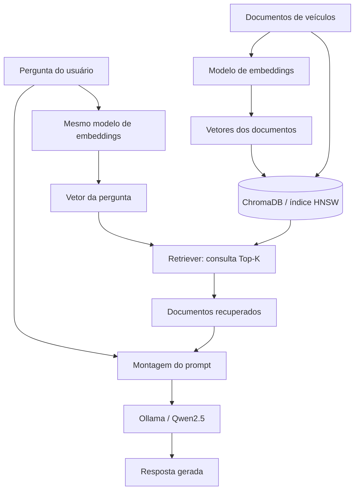

# Laboratório RAG com Python, ChromaDB, Embeddings e HNSW

> Projeto educacional de **Retrieval-Augmented Generation (RAG)** para explorar recuperação semântica, distância de cosseno, busca aproximada de vizinhos mais próximos (ANN), HNSW e geração de respostas com um LLM local via Ollama.

## Objetivo

Implementar um fluxo completo, porém pequeno, de RAG com documentos sobre veículos. O objetivo não é apenas obter uma resposta, mas **observar o que o recuperador encontra, como os resultados são ordenados e como isso afeta a resposta do modelo generativo**.

O laboratório usa:

- **Python** para orquestrar o fluxo;
- **Sentence Transformers** (`paraphrase-multilingual-MiniLM-L12-v2`) para gerar embeddings de textos e perguntas;
- **ChromaDB** para armazenar documentos, vetores e realizar busca vetorial;
- **HNSW**, mecanismo de indexação vetorial usado pela configuração deste laboratório, para busca aproximada;
- **Distância de cosseno** para comparar representações vetoriais;
- **Ollama** com `qwen2.5:1.5b` para gerar a resposta localmente.

## Arquitetura



### Dois fluxos diferentes

**Indexação (preparação):** texto → embedding → armazenamento de vetor e texto no ChromaDB. A indexação não precisa ser repetida a cada pergunta; neste exemplo, usamos `upsert` por simplicidade.

**Consulta (execução):** pergunta → embedding da pergunta → busca vetorial Top-K → documentos recuperados → prompt com contexto → LLM → resposta.

O **retriever** não é o LLM. Ele consulta o banco vetorial e devolve os trechos encontrados. O LLM recebe esses trechos e redige a resposta.

## Estrutura do projeto

```text
rag-hnsw-lab/
├── rag.py              # Exemplo completo de indexação, recuperação e geração
├── README.md           # Esta documentação
├── requirements.txt    # Dependências Python (opcional)
├── .gitignore          # Arquivos locais a ignorar (recomendado)
├── .venv/              # Ambiente virtual local (não versionar)
└── chroma_db/          # Índice persistido localmente (não versionar)
```

O arquivo `main.py`, caso exista no seu diretório, não faz parte obrigatória deste exemplo.

## Pré-requisitos

- Python 3.10+ (compatibilidade exata depende das versões instaladas dos pacotes);
- Ollama instalado e em execução na porta `11434`;
- Espaço em disco para baixar o modelo de embeddings e o modelo generativo;
- Acesso à internet **na primeira execução** para baixar os modelos, caso ainda não estejam em cache.

### Instalação no Linux Mint

```bash
mkdir -p rag-hnsw-lab
cd rag-hnsw-lab
python3 -m venv .venv
source .venv/bin/activate
python -m pip install --upgrade pip
python -m pip install chromadb sentence-transformers requests
```

> No Linux Mint, instale os pacotes Python dentro do `.venv` para evitar o erro `externally-managed-environment` (PEP 668). Não é necessário usar `--break-system-packages`.

Baixe o LLM:

```bash
ollama pull qwen2.5:1.5b
ollama list
```

Se o serviço não estiver ativo, inicie-o em outro terminal:

```bash
ollama serve
```

> O nome do modelo em `rag.py` deve ser idêntico ao listado por `ollama list`.

## Implementação: `rag.py`

```python
import chromadb
import requests
from sentence_transformers import SentenceTransformer

# Base de conhecimento pequena, para facilitar a inspeção dos resultados.
documentos = [
    "Honda Civic é um sedã da Honda.",
    "Toyota Corolla é um sedã da Toyota.",
    "Haval H6 é um SUV híbrido da GWM.",
    "Honda CB 500 é uma motocicleta.",
    "Toyota Hilux é uma picape.",
]

# O mesmo modelo deve gerar embeddings para documentos e perguntas.
modelo = SentenceTransformer(
    "sentence-transformers/paraphrase-multilingual-MiniLM-L12-v2"
)

client = chromadb.PersistentClient(path="./chroma_db")
collection = client.get_or_create_collection(
    name="veiculos",
    metadata={"hnsw:space": "cosine"},
)

vetores = modelo.encode(documentos, normalize_embeddings=True).tolist()
collection.upsert(
    ids=[f"veiculo_{i}" for i in range(len(documentos))],
    documents=documentos,
    embeddings=vetores,
)


def recuperar(pergunta: str, top_k: int = 3) -> list[str]:
    vetor_pergunta = modelo.encode(
        pergunta, normalize_embeddings=True
    ).tolist()

    resultados = collection.query(
        query_embeddings=[vetor_pergunta],
        n_results=top_k,
        include=["documents", "distances"],
    )

    for documento, distancia in zip(
        resultados["documents"][0], resultados["distances"][0]
    ):
        print(f"Distância: {distancia:.4f} | {documento}")

    return resultados["documents"][0]


def gerar_resposta(pergunta: str, contexto: list[str]) -> str:
    prompt = f"""Responda apenas com base no contexto abaixo.
Se não houver informação suficiente, diga que não sabe.

Contexto:
{chr(10).join(contexto)}

Pergunta: {pergunta}
Resposta:"""

    resposta = requests.post(
        "http://localhost:11434/api/generate",
        json={
            "model": "qwen2.5:1.5b",
            "prompt": prompt,
            "stream": False,
        },
        timeout=120,
    )
    resposta.raise_for_status()
    return resposta.json()["response"]


if __name__ == "__main__":
    pergunta = "Qual veículo é um SUV híbrido?"
    contexto = recuperar(pergunta, top_k=5)
    resposta = gerar_resposta(pergunta, contexto)
    print("\nResposta do RAG:")
    print(resposta)
```

Execute:

```bash
python3 rag.py
```

### Configuração importante

`metadata={"hnsw:space": "cosine"}` seleciona a métrica de distância de cosseno para a coleção **na API/configuração usada neste laboratório**. APIs de configuração podem mudar entre versões do ChromaDB. Se a coleção `veiculos` já existir, `get_or_create_collection` **não garante que uma nova métrica substitua a configuração antiga**: para testar outra métrica, crie uma coleção com outro nome ou recrie a coleção de testes.

## Fundamentos: similaridade e distância de cosseno

O **embedding** é um vetor numérico que representa o texto em um espaço vetorial. O modelo procura posicionar textos relacionados relativamente próximos nesse espaço, mas isso **não garante interpretação correta nem recuperação perfeita**.

A similaridade de cosseno mede o alinhamento entre dois vetores:

```text
cos_sim(A, B) = (A · B) / (||A|| × ||B||)
```

A **distância de cosseno** exibida neste laboratório é:

```text
cosine_distance(A, B) = 1 - cos_sim(A, B)
```

- **Distância menor**: maior similaridade angular;
- **Distância maior**: menor similaridade angular;
- **Distância não é probabilidade** e não deve ser lida como “43% de chance de acerto”.

O parâmetro `normalize_embeddings=True` normaliza os vetores para norma unitária. Isso facilita a comparação; a métrica escolhida para a coleção continua sendo a distância de cosseno.

### Exemplo matemático simplificado

Considere `A = [1, 0]`, `B = [1, 0]` e `C = [0, 1]`:

| Comparação | Similaridade de cosseno | Distância de cosseno |
|---|---:|---:|
| A × B | 1,0 | 0,0 |
| A × C | 0,0 | 1,0 |

Esses vetores são **didáticos** e não correspondem aos embeddings reais dos veículos.

## ANN e HNSW

**KNN exato** compara a consulta com os vetores candidatos para encontrar os vizinhos efetivamente mais próximos; o custo pode crescer com o tamanho da base.

**ANN (Approximate Nearest Neighbors)** troca parte da garantia de exatidão por desempenho, procurando vizinhos próximos sem necessariamente examinar todos os vetores.

**HNSW (Hierarchical Navigable Small World)** é um algoritmo ANN baseado em **grafos hierárquicos multicamadas**:

1. Cada vetor corresponde a um nó, conectado a outros vetores considerados próximos;
2. Camadas superiores permitem deslocamentos mais amplos pelo espaço;
3. Camadas inferiores refinam a busca por vizinhos próximos;
4. O resultado é aproximado: velocidade e qualidade dependem da configuração e dos dados.

**Multicamadas não é multimodal**: multimodal se refere a modalidades como texto, imagem e áudio. HNSW não é uma busca binária e não é uma árvore.

Neste projeto, o ChromaDB administra o índice; **não implementamos manualmente o grafo HNSW**. Para apenas cinco registros, o benefício de desempenho não é mensurável de forma significativa.

## Experimento real: efeito do Top-K

Pergunta: **“Qual veículo é um SUV híbrido?”**

Resultado observado no laboratório (valores aproximados, sujeitos a diferenças de versão/ambiente):

| Posição | Documento | Distância de cosseno |
|---:|---|---:|
| 1 | Toyota Hilux é uma picape. | 0,3576 |
| 2 | Honda Civic é um sedã da Honda. | 0,4062 |
| 3 | Toyota Corolla é um sedã da Toyota. | 0,4310 |
| 4 | **Haval H6 é um SUV híbrido da GWM.** | **0,4378** |
| 5 | Honda CB 500 é uma motocicleta. | 0,4850 |

**Com `top_k=3`:** o Haval H6 não entrou no contexto e o LLM respondeu “Não sabe”.

**Com `top_k=5`:** o Haval H6 entrou no contexto e o LLM respondeu “Haval H6”.

### Interpretação

O sistema **executou corretamente**, mas a **ordenação semântica foi ruim para essa pergunta**: o documento esperado ficou em quarto lugar. Isso não prova um defeito no HNSW. Entre as hipóteses estão limitações do modelo de embeddings, descrições muito curtas, formulação da pergunta e características do conjunto de dados.

Aumentar o Top-K melhora a chance de incluir a informação correta, mas também pode aumentar o ruído, a latência e o consumo de tokens. **Mais contexto não é automaticamente melhor.**

### Métricas de recuperação

Neste conjunto, considerando apenas o Haval H6 como relevante:

- **Recall@3 = 0**: nenhum documento relevante entre os três primeiros;
- **Recall@5 = 1**: o documento relevante aparece entre os cinco primeiros;
- **MRR = 1/4 = 0,25**: o primeiro documento relevante está na posição quatro.

Essas métricas descrevem **um único exemplo**, não a qualidade geral do sistema. Uma avaliação séria exige muitas perguntas e julgamentos de relevância.

## Roteiro de testes práticos

### Teste A — Variar o Top-K

No final do `rag.py`, altere:

```python
contexto = recuperar(pergunta, top_k=1)
# depois teste top_k=3 e top_k=5
```

Registre se o Haval aparece e qual resposta o LLM gera. Compare **Recall@K**, latência e quantidade de contexto.

### Teste B — Reformular a consulta

Experimente uma pergunta por execução:

```python
pergunta = "Qual veículo é um SUV híbrido?"
pergunta = "Qual carro da GWM possui motorização híbrida?"
pergunta = "Haval H6 SUV híbrido GWM"
```

**Hipótese:** a formulação da consulta altera o embedding e pode mudar o ranking. Não presuma que a terceira consulta necessariamente terá melhor resultado: **meça**.

### Teste C — Inspecionar o embedding

Logo após criar `vetores`, adicione temporariamente:

```python
print("Quantidade de documentos:", len(vetores))
print("Dimensões do primeiro vetor:", len(vetores[0]))
print("Primeiros componentes:", vetores[0][:8])
```

O vetor não é um texto legível nem uma lista de conceitos explicitamente nomeados. Cada dimensão participa da representação numérica aprendida pelo modelo.

### Teste D — Comparar distâncias diretamente

Adicione este trecho **após carregar o modelo**, sem precisar consultar o ChromaDB:

```python
import numpy as np

frases = [
    "Qual veículo é um SUV híbrido?",
    "Haval H6 é um SUV híbrido da GWM.",
    "Toyota Hilux é uma picape.",
]

emb = modelo.encode(frases, normalize_embeddings=True)
for i in [1, 2]:
    similaridade = float(np.dot(emb[0], emb[i]))
    distancia = 1.0 - similaridade
    print(frases[i], "similaridade=", round(similaridade, 4),
          "distância=", round(distancia, 4))
```

Como os vetores estão normalizados, o produto escalar equivale à similaridade de cosseno, salvo pequenas diferenças numéricas. Esse teste ajuda a separar **qualidade do embedding** de **comportamento do índice**.

### Teste E — Enriquecer o texto do documento

Substitua a descrição curta do Haval por algo como:

```python
"Haval H6, da GWM, é um SUV com motorização híbrida, combinando motor a combustão e motor elétrico."
```

Reexecute a indexação e observe se a posição muda. Este é um experimento sobre **qualidade do conteúdo indexado**; o resultado não é garantido.

### Teste F — Testar uma pergunta sem resposta

```python
pergunta = "Qual é a autonomia elétrica exata do Haval H6?"
```

O contexto disponível **não informa esse número**. O comportamento desejado é reconhecer a ausência de evidência. Em sistemas reais, valide as respostas: o prompt reduz, mas não elimina, alucinações.

## Boas práticas e limitações

- **Corpus pequeno:** cinco documentos servem para entender o fluxo, não para medir escalabilidade do HNSW.
- **Sem chunking real:** cada descrição é tratada como um documento completo. Em PDFs e textos extensos, implemente divisão em trechos com metadados.
- **Sem avaliação automatizada:** adicione um conjunto de perguntas com documentos esperados antes de comparar modelos.
- **Sem reranking:** um segundo estágio pode reordenar os resultados antes de enviá-los ao LLM.
- **Sem busca híbrida:** BM25 (léxica) + busca densa pode ser uma evolução útil para nomes, siglas e códigos de veículos.
- **Persistência local:** a pasta `chroma_db/` armazena dados locais; não deve ser versionada neste laboratório.
- **Mudança de modelo:** se trocar o modelo de embeddings, recrie/reindexe a coleção; não misture vetores de modelos diferentes.
- **Privacidade e segurança:** não indexe dados sensíveis sem política apropriada; documentos recuperados devem ser tratados como dados não confiáveis, não como instruções de sistema.
- **Reprodutibilidade:** fixe versões das dependências ao publicar resultados comparativos; as distâncias e ordenações podem variar.

## Próximas evoluções

1. Separar `ingest.py` (indexação) de `query.py` (consulta) para evitar reindexação a cada execução.
2. Criar documentos maiores e implementar **chunking** com metadados de origem.
3. Medir **Recall@K, MRR, latência e custo** em um conjunto de perguntas.
4. Comparar modelos de embeddings multilíngues.
5. Adicionar **reranking** e comparar a ordem antes/depois.
6. Implementar **busca híbrida** (BM25 + vetorial), por exemplo com OpenSearch.
7. Expor a recuperação e a geração via API HTTP.
8. Adicionar testes automatizados e observabilidade.

## Literatura e referências

### Livro que motivou o laboratório

- **Chip Huyen — _Engenharia de IA_ (_AI Engineering_)**. Seções sobre recuperação de contexto, embeddings, RAG e avaliação de sistemas de IA. Foi a referência de estudo para a discussão dos conceitos; **o código deste repositório é uma implementação didática própria, não uma reprodução de exemplo do livro**.

### Artigos fundamentais

- **Malkov, Y. A.; Yashunin, D. A.** _Efficient and Robust Approximate Nearest Neighbor Search Using Hierarchical Navigable Small World Graphs_. IEEE TPAMI (2020). Preprint: https://arxiv.org/abs/1603.09320
- **Lewis, P. et al.** _Retrieval-Augmented Generation for Knowledge-Intensive NLP Tasks_ (2020). https://arxiv.org/abs/2005.11401

### Documentação de implementação

- ChromaDB: https://docs.trychroma.com/
- Sentence Transformers: https://www.sbert.net/
- Ollama API: https://docs.ollama.com/api
- NumPy: https://numpy.org/doc/

## Glossário rápido

| Termo | Significado |
|---|---|
| **RAG** | Geração aumentada por recuperação de informações externas |
| **Embedding** | Representação vetorial numérica de um conteúdo |
| **Vector Store** | Sistema que armazena e consulta vetores e metadados |
| **Retriever** | Componente que seleciona documentos relevantes |
| **Top-K** | Quantidade de documentos retornados pela busca |
| **Cosine similarity** | Similaridade angular entre vetores |
| **Cosine distance** | `1 - similaridade de cosseno` |
| **ANN** | Busca aproximada de vizinhos mais próximos |
| **HNSW** | Algoritmo ANN baseado em grafos hierárquicos |
| **Recall@K** | Fração dos itens relevantes recuperados nos primeiros K |
| **MRR** | Média do inverso da posição do primeiro item relevante |
| **Reranking** | Reordenação de candidatos após a recuperação inicial |

## Publicação no GitHub

Crie um `.gitignore` com:

```gitignore
.venv/
__pycache__/
*.py[cod]
chroma_db/
.env
.vscode/
```

Opcionalmente, gere um `requirements.txt` com as versões efetivamente instaladas:

```bash
python -m pip freeze > requirements.txt
```

Depois, no repositório Git já configurado:

```bash
git add README.md rag.py requirements.txt .gitignore
git commit -m "docs: documenta laboratorio RAG com embeddings e HNSW"
git push origin main
```

> Ajuste a branch se estiver usando outro nome. Antes de publicar, revise se não há segredos, dados privados ou artefatos locais versionados.

---

**Conclusão:** o objetivo do laboratório não é provar que a busca vetorial sempre acerta. É compreender o ciclo **documento → embedding → índice HNSW → recuperação Top-K → contexto → LLM** e saber medir quando a recuperação falha.
# lab_rag
# lab_rag
